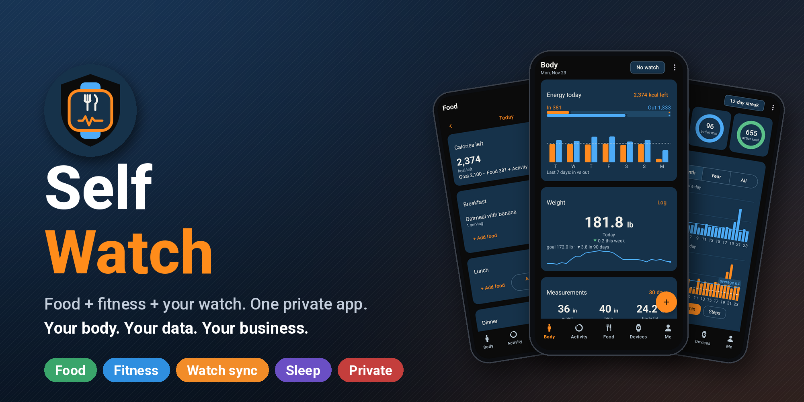
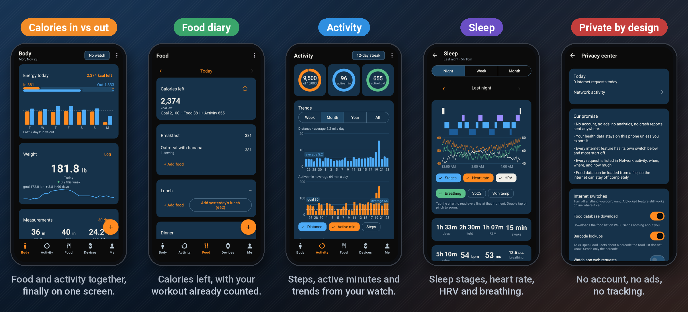

# ⌚ Self Watch



### Calorie counter + fitness tracker + watch sync, in one private app

Today, tracking your health takes three apps from three companies: the watch maker's app for steps and sleep, a calorie counter for food, and a health dashboard to stitch them together. Each one wants an account, and each one sends your data to its own cloud.

**Self Watch merges them into one.** It connects directly to your Garmin watch over Bluetooth, keeps your food diary, and puts calories in and calories out side by side, all on your phone. Your data, connected for you, by you, locally.

Free, open source, and private by design. **No account, no cloud, no ads, no tracking.**

> **Status: early development (0.0.1).** The app is built and runs, and it has synced with a real vívoactive 5. Test builds are on the [Releases](../../releases) page.



## 🔒 Why this exists

What you eat and how you move are two halves of the same picture, but they usually live in separate apps that only meet through somebody's server. Your heart rate, your sleep, your meals and your weight are some of the most personal facts about you.

Self Watch puts both halves in one place and keeps them there. The watch talks to the app directly, the food diary is on the same phone, and the two are joined on the device, never in a company's cloud.

- 💸 **Free.** No ads, no subscriptions, no in-app purchases.
- 🔒 **Private.** No account, no analytics, no crash reports. No Google Play Services. Runs on GrapheneOS and LineageOS.
- 📴 **Offline first.** Every internet feature has its own switch, most start off, and every request is listed in the app.
- 🧾 **Open.** Licensed under the AGPL-3.0, so it stays free.

*Know thyself. Tell no one.*

## ✨ Features

### 🧍 Body

- ⚖️ Weight with a trend line, weekly change and progress to your goal.
- 📏 Waist, hips and body fat.
- 🔥 Calories in vs out for today and the last 7 days.

### 🏃 Activity and workouts

- 👟 Steps, active minutes and active calories, with streaks.
- 📊 Week, month, year and all-time trends.
- 🚴 Every workout with its route, heart rate, speed and splits, drawn on the phone (no map service).
- 📤 Export workouts as GPX, TCX or the original FIT file.

### 😴 Sleep

- 🌙 Sleep stages for each night: deep, light, REM and awake.
- ❤️ Heart rate, HRV, breathing rate and SpO2 through the night.

### 🍎 Food diary

- 🔍 Search foods, scan a barcode with the built-in camera (no pictures are saved), or re-log a recent food in one tap.
- 🍽️ Custom foods, saved meals and recipes.
- 🎯 Calories left for the day, with your activity added in.
- 📴 Works with no internet at all; the food list can be loaded from a file.

### ⌚ Watch

- 🔗 Pairs directly with your Garmin watch over Bluetooth. No Garmin account needed.
- 🔄 Syncs steps, sleep, heart rate, workouts and more.
- 🔔 Phone notifications on the watch, with a per-app switch.
- 🧩 Lets phone apps talk to Connect IQ watch apps, with your permission for each one.

### 🔄 Import and export

- 📥 Bring your history from Gadgetbridge, Garmin Connect exports, FIT/GPX/TCX files, popular calorie-counting apps and recipe managers.
- 📤 Export to CSV, JSON, GPX, TCX and FIT, or make a full backup (optionally encrypted) to a folder you choose.
- 🩺 Optional Health Connect sync on Android 14 and newer.

### 🛡️ Privacy center

- 📋 A log of every internet request: when, where and how much.
- 🎚️ A switch for each internet feature. A blocked feature still works offline where it can.

## ⌚ Watches

Self Watch talks to Garmin watches directly, using its own implementation of the Bluetooth protocol.

- ✅ **Tested:** vívoactive 5.
- 🟡 **Expected to work:** other current Garmin watches that use the same protocol. The app says when a model hasn't been verified yet.
- ❌ **Not supported yet:** older Garmin devices and other brands. More families will be added over time.

Phones: Android 8.0 or newer.

## 📲 Getting the app

Download the signed APK from the [Releases](../../releases) page, or add this repository to [Obtainium](https://github.com/ImranR98/Obtainium) for automatic updates (Android 8 or newer). F-Droid is planned.

## 🛠️ Building from source

Requirements: JDK 21 and the Android SDK (platform 37, build-tools 36).

```
./gradlew build              # compile, unit tests, lint, license check
./gradlew installDebug       # install on a connected phone
```

The build fails on purpose if Google Play Services, Firebase, an analytics library or any native code is added. See [CONTRIBUTING.md](CONTRIBUTING.md).

## 🙏 Credits

| Part | Source | Terms |
|---|---|---|
| Food data | [Open Food Facts](https://world.openfoodfacts.org) contributors | [ODbL 1.0](https://opendatacommons.org/licenses/odbl/) |
| Barcode decoding | [ZXing](https://github.com/zxing/zxing) | Apache License 2.0 |
| Protocol buffers | [protobuf-javalite](https://github.com/protocolbuffers/protobuf) | BSD 3-Clause |

Self Watch is written from scratch. [Gadgetbridge](https://codeberg.org/Freeyourgadget/Gadgetbridge), Pulse and Internet Helper (AGPL-3.0) were studied as references to learn how Garmin watches communicate; no code was copied. Thanks to their authors.

## ℹ️ Trademarks

Self Watch is an independent, non-commercial project. It isn't affiliated with, endorsed by or connected to Garmin Ltd. or any other company. Garmin, vívoactive and Connect IQ are trademarks of Garmin Ltd. or its subsidiaries, used here only to say which devices the app works with.

## 📜 License

The app is licensed under the **GNU Affero General Public License v3.0 or later**. See [LICENSE](LICENSE). The `link-client` library that other apps use to talk to Self Watch is Apache-2.0 (see [link-client/LICENSE](link-client/LICENSE)).

Privacy: [PRIVACY.md](PRIVACY.md).
