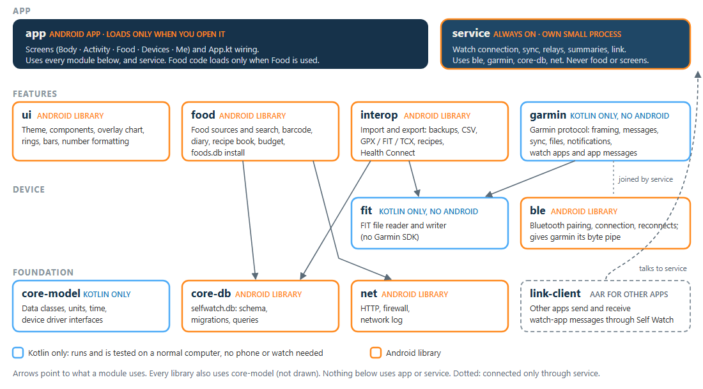

# Self Watch: code plan

Draft v0.2, 2026-11-22 (always-on service split out). **The detailed build plan (work packages per module, compatibility rules, 157-task list) is in [build-plan/](build-plan/README.md).** Companion to [DESIGN.md](DESIGN.md) (what and why) and [APP_LAYOUT.md](APP_LAYOUT.md) (screens and menus). The Word document is the primary copy. Module diagram: `layout/modules.png` (source `layout/modules.html`).

## 1. Principles

1. **Written from scratch.** Gadgetbridge, Pulse and Internet Helper are read, never copied. Where a protocol detail came from a reference, leave a one-line comment, for example `// Ref: Gadgetbridge 160beab41 garmin/messages/DownloadRequestMessage.java (status codes)`, so the maintainer agent can compare against later fixes there.
2. **Size first.** No native libraries. Libraries for standard plumbing only (section 7). CI fails a build that goes over the size budget.
3. **Kotlin-only where possible.** The Garmin protocol, the FIT reader and writer, and the data model don't use Android at all. They run and are tested on a normal computer, fast, with no phone or watch, including in the maintainer agent's sandbox.
4. **One direction for data:** watch → protocol → database → summaries → screens. Screens never talk to the watch; they read the database and ask the app to do things.
5. **Store plainly, format late.** Whole numbers (×10, ×100), metric units and UTC times in storage. Units, rounding and local time only on screen.
6. **Everything the user owns is in `selfwatch.db`** plus the workout FIT files. Food data and the starter recipe book are replaceable files beside it.
7. **Only the watch connection runs all the time.** It lives in `service`, in its own small process, and can't load food, import and export, or screens. Everything else loads only when you open it.

## 2. Module map



| Module | Kind | Job | Uses |
|---|---|---|---|
| `app` | Android app | Screens and wiring; loads only when opened | everything |
| `service` | Android library, own process | The always-on part: watch connection, sync, relays, summaries, link service | core-model, core-db, ble, garmin, net |
| `ui` | Android library | Theme, components, charts, formatting | core-model |
| `food` | Android library | Food sources and search, barcode, diary, recipe book, budget, foods.db install | core-model, core-db, net |
| `interop` | Android library | Import, export, backup, Health Connect | core-model, core-db, fit |
| `garmin` | Kotlin only | Garmin protocol and features | core-model, fit |
| `fit` | Kotlin only | FIT reader and writer | nothing |
| `ble` | Android library | Bluetooth pairing, connection, write queue, reconnects | core-model |
| `core-model` | Kotlin only | Data classes, units, time, device driver interfaces | nothing |
| `core-db` | Android library | `selfwatch.db` schema, migrations, queries | core-model |
| `net` | Android library | HTTP, firewall, network log | core-model |
| `link-client` | Android library (AAR), Apache-2.0 | What other apps add to talk to their watch apps through Self Watch | nothing |
| `tools/fooddb` | Not built by Gradle | Tony's desktop build of `foods.db` and the starter recipe book | — |
| `testdata/` | Files | Real FIT files, recorded watch sessions, sample exports, recipe files | — |

`garmin` can't use `ble` (Kotlin only versus Android). `ble` provides a byte pipe, `garmin` talks through it, and `service` plugs one into the other. A future device family (for example smart scales) is one more module beside `garmin`.

## 3. Modules in detail

### core-model (Kotlin only)

```
time/      Day (local date as YYYYMMDD), TimeRange, Clock (fake one for tests)
units/     Mass, Length, Energy, Volume as whole-number value classes; conversions
health/    ActivityMinute, Metric (heart rate, HRV, SpO2, breathing, stress, temperature),
           SleepStage, SleepSession, Workout, TrackPoint, BodyMeasure, DaySummary
food/      Food, FoodRef (source + id), Serving, Nutrients, DiaryEntry, MealSlot,
           Recipe, RecipeItem, Goal
device/    WatchDriver, ScaleDriver (later), BytePipe, DeviceInfo, Capabilities,
           HealthSink (where a driver hands over new data), WatchCommand
           (notification, call, music, find, alarms, weather, app message)
```

### core-db (Android library)

- `SelfWatchDb`: one `SQLiteOpenHelper`, WAL mode, foreign keys on, schema version in `PRAGMA user_version`.
- `schema/`: `V1.sql` and one file per later migration. Migrations are tested by upgrading a copy of every past version.
- `dao/`: one small class per area (`DeviceDao`, `ActivityDao`, `MetricDao`, `SleepDao`, `WorkoutDao`, `BodyDao`, `DiaryDao`, `FoodDao`, `RecipeDao`, `GoalDao`, `SummaryDao`, `WatchAppDao`, `LinkDao`, `NetLogDao`, `ImportDao`, `SettingDao`). Plain SQL, compiled statements and batches for bulk inserts.
- Table outline: section 4.

### fit (Kotlin only)

```
io/        FitReader (streams records; header, definitions, developer fields, CRC check),
           FitWriter (header, definitions, data, CRC)
profile/   The FIT messages and fields Self Watch uses, as a small hand-written table:
           file_id, device_info, event, monitoring, monitoring_info, record, lap,
           session, activity, sleep level and assessment, HRV, stress, respiration,
           SpO2, weight_scale
decode/    MonitoringDecoder → ActivityMinute and Metric; SleepDecoder; WorkoutDecoder
           (session, laps, track); HrvDecoder; WeightDecoder
encode/    WeightFileWriter (for Garmin Connect weight import)
```
Workout FIT files are kept as received, so the writer only needs weight files. Tests: decode real files from `testdata/fit/` and compare with known totals.

### ble (Android library)

- `Pairing`: Android's Companion Device Manager, available from Android 8.0 (our minimum). The system shows the device picker, so Self Watch never needs the location permission to find a watch.
- `BleConnection`: connect, discover services, raise the packet size, enable notifications, a one-at-a-time write queue, timeouts, reconnect with back-off.
- `GattBytePipe`: turns a pair of characteristics into the `BytePipe` that `garmin` uses.
- `BleLog`: optional capture of every packet to a file, for bug reports and for test recordings.

### garmin (Kotlin only)

Layered the way the protocol is (learned from Gadgetbridge's `communicator/`, `messages/` and handlers):

```
link/        MultiLink: registers services over Garmin's shared Bluetooth service and routes
             bytes for each one; Cobs framing; Crc16
gfdi/        Message ids, MessageReader and MessageWriter, status and acknowledgements,
             request-reply matching with timeouts
session/     GarminSession: handshake (device information, configuration, capabilities),
             time sync, battery, keep-alive; a state machine with explicit states
files/       Directory listing, download, upload, create, set flags; SyncPlan (which files
             are new, using the sync_file table); hands FIT bytes to fit/decode
pb/          Our own .proto files for only the messages we use (field numbers learned from
             the reference); ProtobufService: request and reply, chunking
features/    Notifications, Calls, Music, FindPhone and FindWatch, Alarms, Weather,
             DeviceSettings, Agps (GPS assistance upload), WebRequests (watch-app internet,
             through net's firewall), WatchApps (list, install .prg, delete, settings),
             AppMessages (Connect IQ messages both ways). Watch-app web requests to 127.0.0.1
             go to the local phone app (as the TCS Companion uses), are logged, and are
             not treated as internet use
models/      Garmin product list as one data file (product id → name, capabilities),
             not one class per model
GarminDriver implements WatchDriver and wires the layers together.
```

Tests: each layer is unit-tested on its own. **Recorded sessions** (captured with `BleLog` from HappyRock's vívoactive 5) replay through the whole stack, so protocol changes can be tested without a watch.

### food (Android library)

```
source/    FoodSource interface (search, by barcode, get); MyFoodsSource (custom foods,
           recipes, history); FoodsDbSource (read-only foods.db, FTS4; optional);
           OffSource (Open Food Facts online, through net); FoodSearch merges them in order
barcode/   Gtin (normalize, check digit, GTIN-14); BarcodeAnalyzer (CameraX + ZXing)
diary/     DiaryService (log, move, copy yesterday's meal, quick add); Favorites; Recents
recipes/   RecipeService (recipes and saved meals); IngredientParser ("2 cups flour" →
           amount, unit, food words); IngredientMatcher (to food sources, user confirms);
           RecipeNutrition (stated, or worked out from matched ingredients)
budget/    Bmr (Mifflin-St Jeor); EnergyBudget (goal − food + activity = remaining)
install/   FoodDbInstaller, RecipeBookInstaller: download (Wi-Fi only) or load from file,
           checksum, gunzip, schema check, swap in one step
```

### interop (Android library)

```
api/       Importer (sniff a file → confidence; plan → ImportPlan; commit → ImportResult),
           Exporter; ImportPlan holds preview rows, detected date format and units,
           counts, duplicates and warnings; every commit gets an import id for undo
io/        Document picker helpers, zip, CsvReader and CsvWriter, ColumnMatcher (names and
           known variants), DateFormatDetector, UnitDetector
backup/    Self Watch backup: selfwatch.db snapshot + settings + workout FIT files;
           optional passphrase encryption (AES, built into Android); restore; scheduled backup
csv/       MyFitnessPal, Lose It!, Cronometer readers; Cronometer-layout writer;
           Garmin body CSV writer; food-list CSV in and out; JSON writer
workout/   GpxWriter (GPX 1.1 + Garmin track-point extension: heart rate, cadence,
           temperature), TcxWriter, original FIT pass-through; GPX, TCX and FIT readers;
           date-range zip; automatic export after each sync
vendor/    GadgetbridgeBackupReader (opens its database from the zip with Android's SQLite;
           also reads Pulse backups); GarminExportReader (Garmin Connect account export)
recipes/   Readers: schema.org JSON-LD, Paprika, Mealie, Tandoor, Meal-Master, Cooklang.
           Writer: schema.org JSON in Nextcloud Cookbook layout
hc/        Health Connect read and write (optional)
```

### net (Android library)

- `HttpClient` on Android's built-in `HttpURLConnection` (no extra HTTP library). Every request names its `Feature` (food data, Open Food Facts, watch-app web request, GPS assistance…).
- `Firewall`: checks the feature's switch before any request. Off by default, except food data, watch app web requests, apps on this phone (127.0.0.1) and GPS help (`NetFeature.defaultOn`).
- `NetworkLog`: writes time, feature, host, bytes and result for every request, allowed or blocked.
- Later, with the first device that needs them: Wi-Fi join, FTP, UDP.

### ui (Android library)

- `theme/`: 5K palette (orange #FF8A1F, blue #4DABF7, off-white, black, navy), type scale, dark and light.
- `components/`: Card, StatTile, ToggleChip group, ListRow, EmptyState, Sheet.
- `charts/`: **OverlayChartView** (custom drawing: lines, bars, bands and sleep-stage blocks on one time axis, left and right scales, toggle chips, scrub to read every value at a time), RingView, BarsView, Sparkline. Charts also expose their values as text for screen readers.
- `format/`: numbers, units and dates in the phone's language and units.

### service (Android library, its own small process)

The only part that runs all the time. It doesn't depend on `food`, `interop`, `ui` or any screen, so the build itself stops it from loading them.

```
SyncService    Foreground service of type "connected device" while a watch is connected;
               runs in its own process (":watch"), so the rest of the app can be fully closed
presence/      Companion Device Manager presence (Android 12+): the system wakes the service
               when the watch comes in range and lets it rest while the watch is away
DeviceManager  Joins ble to drivers; SyncScheduler; connection mode (always connected or sync only)
HealthIngest   Implements HealthSink: writes to core-db, then updates summaries
relay/         NotificationRelay (notification access), CallRelay, MusicRelay (media sessions),
               WeatherRelay (from weather apps that broadcast forecasts)
health/        SummaryBuilder (day summaries; weeks, months and years are added up from days)
link/          LinkService (bound service for link-client), LinkPermissions,
               GadgetbridgeIntentReceiver (SEND_WATCH_APP_MESSAGE compatibility),
               CaloriesLeft (reads the day summary, not the food module)
```

### app (Android app, loads only when opened)

```
App.kt       Builds shared objects lazily (no Hilt): nothing food-related is created until a
             food screen asks for it
ui/          shell, body, activity, food, devices, me (screen list in APP_LAYOUT.md);
             EnergyToday and Trends read the summaries for Body and Activity
```
Screens: Fragment + ViewModel + StateFlow. No navigation library: the bottom tabs swap fragments, and detail screens go on the back stack. Screens and `service` share `selfwatch.db` (SQLite handles two processes safely in WAL mode); `service` tells open screens about new data with a small broadcast inside the app.

### link-client (Android library, AAR)

- **Same shape as Garmin's phone toolkit, under our own names** (DESIGN.md §4): `SelfWatchLink.connect(context, listener)` → `devices()`, `appInfo(device, appId)` (installed or not, version), `send(device, appId, message) → delivery result`, `onMessage(device, appId) { … }`, `openApp(device, appId)`.
- Messages are lists, maps, strings, numbers, booleans and null, converted to Monkey C values on the way to the watch and back. Size limit: about 14 fragments.
- **License: Apache-2.0**, so any app can use it.
- A sample app shows one companion app supporting both Garmin Connect and Self Watch.
- The interface file (AIDL) is shared with `app/link`. The first use triggers Self Watch's permission screen ("Allow Third Coast Sailing to message its watch app?").
- No dependencies, so it adds almost nothing to the other app.

## 4. `selfwatch.db` outline (version 1)

| Area | Tables (key columns) |
|---|---|
| Devices | `device` (id, kind, model, name, address, firmware, added, last_sync); `sync_file` (device, watch file index, type, size, time, state) so nothing downloads twice |
| Activity | `activity_minute` (device, minute → steps, active kcal ×10, distance, intensity); `WITHOUT ROWID`, keyed by device and time |
| Metrics | `metric` (kind, device, time → value ×10): heart rate, HRV, SpO2, breathing, stress, temperature; one compact table for every sparse series |
| Sleep | `sleep_session` (device, start, end); `sleep_stage` (device, time → stage) |
| Workouts | `workout` (device, sport, start, end, duration, distance, kcal, average and max heart rate, ascent, has_track, FIT file path, route preview). Track points stay in the FIT file and are read when needed |
| Body | `body_measure` (time, kind, value ×100, source, import id); `measure_kind` (custom measurements and their units) |
| Food | `custom_food` + `custom_serving` (same columns as foods.db, plus barcode and source); `diary_entry` (day, meal slot, time, food ref, name, amount, grams, **copied nutrients**, import id); `meal_slot`; `favourite`; `water`; `fast` |
| Recipe book | `recipe` (kind: recipe or saved meal, name, servings, steps, source, stated nutrition per serving, tags, import id); `recipe_item` (recipe, order, original line, food ref, amount, unit, grams, match state) |
| Goals and settings | `goal` (kind, value, from day), so past days keep the goal they had; `setting` (key → value), so a backup is one file |
| Summaries | `day_summary` (day → steps, active and resting kcal, distance, active minutes, resting heart rate, HRV, sleep, kcal eaten, macros, weight) |
| Watch apps | `watch_app` (device, app id, name, version); `watch_app_settings` (app id, saved time, values) |
| Link | `link_permission` (package, app id, allowed, last used) |
| Network | `net_log` (time, feature, host, bytes up and down, result) |
| Imports | `import_batch` (id, time, source, file name, counts); rows in other tables carry its id for one-step undo |

## 5. Key flows

**Sync.**
1. `ble` connects.
2. `garmin` runs the handshake and sets the time.
3. `garmin` lists the watch's files, and `SyncPlan` picks the new ones.
4. Each file is downloaded:
   - Monitoring and sleep files are decoded by `fit` and handed to `HealthSink`.
   - Workout files are saved as received, with a summary row.
5. `HealthIngest` writes everything in one transaction per file and marks the file done in `sync_file`.
6. `SummaryBuilder` refreshes the affected days. Screens update from the database.

**Log food.**
1. Add food searches `FoodSearch`: My foods, then foods.db, then Open Food Facts if allowed.
2. The user picks a serving.
3. `DiaryService` writes a `diary_entry` with copied nutrients.
4. The day summary updates the energy card. `CaloriesLeft` sends the new budget to the watch app, if linked.

**Import.**
1. The user picks a file.
2. Each `Importer` sniffs it, and the best match builds an `ImportPlan`.
3. The preview screen shows rows, the detected date format and units, and duplicates. The user confirms.
4. `commit` writes everything under one import id. Undo deletes by that id.

**Watch-app message.**
1. A phone app calls `link-client`.
2. `LinkService` checks `LinkPermissions`.
3. `garmin` `AppMessages` sends the message to the watch app.
4. Replies from the watch come back the same way, to the app that owns that watch app.

**GPX export.**
1. The workout's FIT file is read by `fit`.
2. `GpxWriter` streams the track points (with heart rate, cadence and temperature) to the chosen file. A date range writes one GPX per activity into a zip.

## 6. Cross-cutting

- **What runs all the time:** only `service`, in its own small process, while a watch is connected. That keeps notifications, calls and app messages working, as Garmin Connect and Gadgetbridge do. An idle Bluetooth connection uses little battery, and syncs are batched. Android requires a small notification while it runs; it is silent, and the user can hide it.
- **Connection modes (Me → Settings):** *Always connected* (the default: notifications, calls and app messages work) or *Sync only* (connects on a schedule and when the app is opened, then disconnects; for people who only want their data).
- **Food only when used:** Android loads code only when it is first used, and `service` can't reach food code at all. `foods.db` opens on the first search and closes a few minutes after leaving the food screens. Food has no background jobs; food data updates are checked only from the Food data screen. A **Food tracking** switch hides the Food tab and food items for people who only want the watch.
- **Not used:** Google Play's download-on-demand modules. They need Google Play, which F-Droid users don't have, and they aren't needed: the food code is small, and the big part, `foods.db`, is already a separate optional download.
- **Threads:** Kotlin coroutines. Database and Bluetooth work on IO threads, decoding on background threads, never on the screen thread.
- **Permissions, only when needed:**
  - Bluetooth connect.
  - Notification access (for the notification relay).
  - Phone state (for calls).
  - Camera (only while scanning).
  - Post notifications (for the sync status).
  - Foreground service, of the connected-device type.
  - Internet.
  - Health Connect (optional).
  - No location permission (see Pairing).
- **Privacy:**
  - `android:allowBackup="false"`, so health data never goes to cloud backup without the user choosing it.
  - Backups can be encrypted with a passphrase.
  - No crash reporting or analytics.
- **Logs:** a local rotating log (and optional Bluetooth packet capture) that the user can export from About and attach to a bug report.
- **Time:** UTC seconds in storage; each day row records its time-zone offset, so travel doesn't split or merge days wrongly.
- **Units:** follow the phone by default; metric in storage.
- **Text:** all strings in resource files, ready for translation. English first.
- **Accessibility:** content descriptions everywhere; every chart can be read as text.

## 7. Build, libraries and tests

- **Build:** Gradle with Kotlin build scripts and one version catalog. Current stable Android Gradle Plugin and Kotlin. minSdk 26, target the newest. R8 full mode and resource shrinking. Library versions pinned, and never newer than two weeks at the time they're added.
- **Libraries (plumbing only):**
  - AndroidX core, AppCompat, Fragment, RecyclerView and Lifecycle (ViewModel).
  - Kotlin coroutines.
  - Material Components.
  - protobuf-lite (Garmin messages).
  - CameraX and ZXing core (barcodes).
  - Health Connect client.
  - Test only: JUnit and Robolectric, which don't ship in the app.
- **Tests:**
  - Unit tests in every module.
  - Real files in `testdata/`: FIT files, recorded watch sessions, export files from each app, recipe files.
  - Database migration tests.
  - A few on-device tests for Bluetooth and the database.
- **CI on every pull request:**
  - Build, unit tests and Android lint.
  - A size check against the budget.
  - A license check of every library.
  - A reproducible-build check for F-Droid.

  The maintainer agent runs the same checks before opening a pull request.

## 8. Build order

| Milestone | What gets built | Done when |
|---|---|---|
| **M0 Foundations** | Gradle modules, CI, theme, empty tabs, `selfwatch.db` v1, logs, settings | The app installs with five empty tabs, CI passes, and the size baseline is recorded |
| **M1 Garmin connection** (the spike) | `ble`, `garmin` link, gfdi, session and files; `fit` decoders; `HealthIngest` | A vívoactive 5 pairs and syncs a day of data into the database; a recorded session replays in tests |
| **M2 Body and Activity** | Summaries, OverlayChartView, Body home, Activity tab, sleep and heart detail, workouts, **GPX / FIT / TCX export**, weight and measurements, goals, profile | Real data on Body and Activity; a real run's GPX opens in a map app |
| **M3 Food** | Diary, custom foods, **recipe book**, quick add, barcode with Open Food Facts, energy budget; `net` firewall and log (first internet use) | A full day can be logged without foods.db |
| **M4 Import and export** | All of `interop`: backups and restore, CSV readers and writers, Gadgetbridge and Garmin imports, recipe formats | Every format passes its sample-file tests; backup on one phone restores on another |
| **M5 Watch features** | Notifications, calls, music, find, alarms, weather; Connect IQ install and settings editor; app messages, `link-client`; calories left on the watch | All work on the vívoactive 5; Just Go 5K installs and its settings edit; TCS message round trip |
| **M6 Privacy and polish** | Privacy center, Health Connect, onboarding, widgets; foods.db and starter recipe book plug-ins when Tony delivers | Privacy screens complete; foods.db search works offline |
| **M7 Release** | Signing, F-Droid metadata, store assets, docs | Reproducible F-Droid build; first public release |

Watch-app messaging (M5) can move earlier if the TCS Companion needs it sooner. foods.db can plug in any time after M3.

## 9. Conventions

- **Packages:** `app.selfwatch.<module>.<area>` (placeholder until the app ID is final).
- **Names:** `…Service` does work; `…Dao` reads and writes tables; `…Reader` and `…Writer` handle files; `…Driver` talks to a device.
- **File header:** the AGPL-3.0 notice with Self Watch's own copyright. Reference comments as in section 1.
- **Commits and pull requests:** small, one topic each. The maintainer agent only opens pull requests; HappyRock merges.
